<!-- Generated by scripts/sync_portfolio.py from data/life.json and data/github.json. -->

  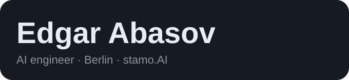

  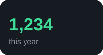
  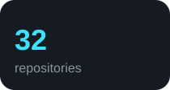
  
  

  
   
  Python 65% · HTML 22% · JavaScript 8% · Shell 2% · CSS 2% · Other 1%
   
  Notebook files left out.

  
  
  
  

  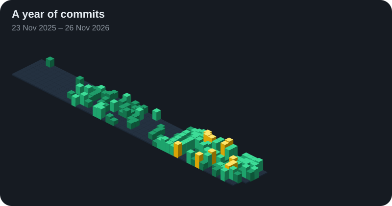
  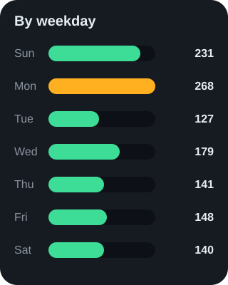

  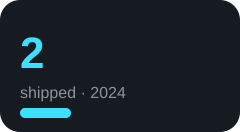
  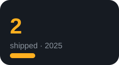
  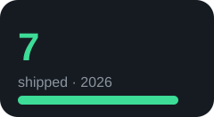

  <a href="https://metaphysicist1.github.io/papercrawl/">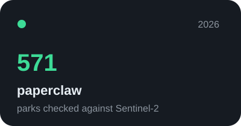</a>
  <a href="https://wortweg.online">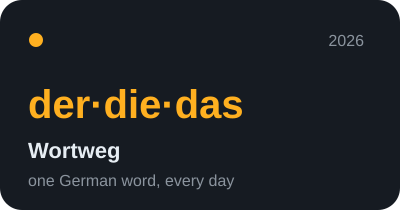</a>
  <a href="https://github.com/Metaphysicist1/ClipVault">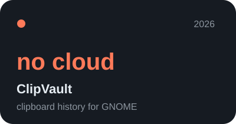</a>
  <a href="https://github.com/Metaphysicist1/PneuNet">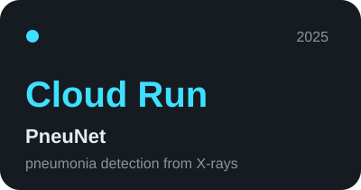</a>
  <a href="https://github.com/Metaphysicist1/Supply-AI-Agent">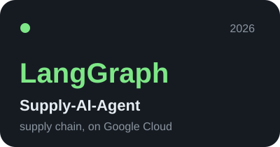</a>
  <a href="https://neuro-timer.netlify.app/">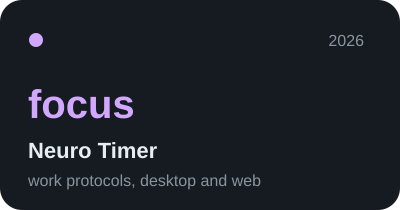</a>

  
  
  
  

  <a href="https://metaphysicist1.github.io/papercrawl/">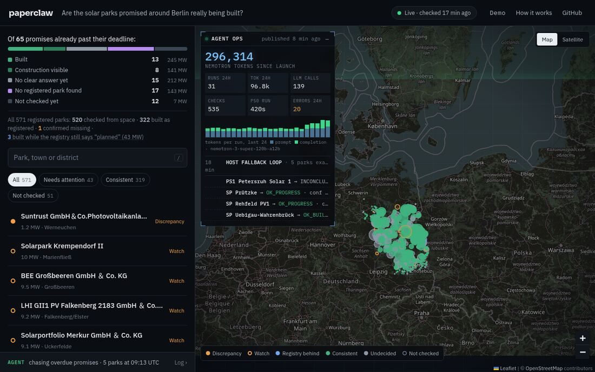</a>
  <a href="https://wortweg.online">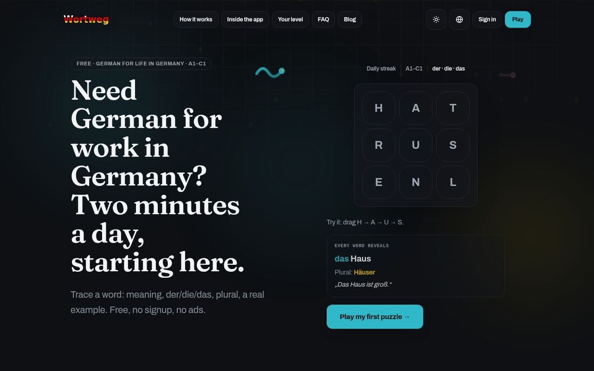</a>

  

  

  

The same work, as text

- [paperclaw](https://metaphysicist1.github.io/papercrawl/) — An always-on agent that checks 571 registered solar parks in Berlin/Brandenburg against the official registry and Sentinel-2 satellite images, and flags megawatts that exist only on paper. Built for the NVIDIA Berlin Claw Agent Challenge.
- [Wortweg](https://wortweg.online) — A daily German word puzzle: trace a word on the grid, get its der/die/das, plural and a real example. A1–C1, free, no signup, no ads.
- [ClipVault](https://github.com/Metaphysicist1/ClipVault) — Clipboard history for GNOME. GTK4, no cloud, no telemetry.
- [PneuNet](https://github.com/Metaphysicist1/PneuNet) — Pneumonia detection from chest X-rays. PyTorch CNN behind FastAPI, on Cloud Run.
- [Supply-AI-Agent](https://github.com/Metaphysicist1/Supply-AI-Agent) — Supply-chain agent on Gemini and LangGraph, deployed on Google Cloud.
- [Neuro Timer](https://neuro-timer.netlify.app/) — Focus timer with work protocols. Desktop and web.

