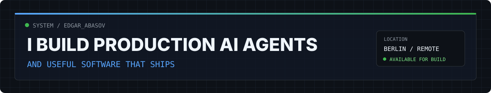

<!-- Generated by scripts/sync_portfolio.py from data/life.json. -->

  

  <a href="https://www.edgarabasov.website"><b>PORTFOLIO</b></a> ·
  <a href="https://www.linkedin.com/in/edgar-abasov/">LinkedIn</a> ·
  <a href="https://x.com/AbasovEdgar">X</a> ·
  <a href="mailto:edgarabasov1@gmail.com">Email</a>

### System status

| Signal | Status |
|:--|:--|
| **PRIMARY ROLE** | AI Engineer · Berlin, Germany |
| **CURRENT THESIS** | Production agents + useful software |
| **LIVE MONITOR** | [paperclaw](https://metaphysicist1.github.io/papercrawl/) · **571** solar parks indexed |
| **PARALLEL WORK** | [relay](https://github.com/Metaphysicist1/relay) · isolated git worktrees |
| **MODEL QUALITY** | **+15%** chatbot accuracy at Bank of Georgia |
| **CERTIFICATIONS** | AWS ML Specialty · Azure Data Scientist |

## Production systems

| 01 · MONITOR | 02 · BUILD |
|:--|:--|
| [**paperclaw**](https://github.com/Metaphysicist1/papercrawl) Satellite + registry evidence for 571 Berlin/Brandenburg solar parks. | [**relay**](https://github.com/Metaphysicist1/relay) One prompt, parallel coding agents, isolated git worktrees. |
| [**ai-radar**](https://github.com/Metaphysicist1/ai-radar) Daily AI engineering briefings and urgent Telegram alerts. | [**telegram-daily-delivery**](https://github.com/Metaphysicist1/telegram-daily-delivery) Encrypted delivery with deterministic duplicate suppression. |

| 03 · ADMIT | 04 · SERVE |
|:--|:--|
| [**unimate**](https://github.com/Metaphysicist1/unimate) AI companion for German university admissions → [unimate.study](https://unimate.study). | [**Supply-AI-Agent**](https://github.com/Metaphysicist1/Supply-AI-Agent) Gemini + LangGraph supply-chain agent on Google Cloud. |

## Pipeline

## Evidence

| Shipped | Proof |
|:--|:--|
| [Wortweg](https://wortweg.online) | Free A1–C1 German word puzzle; no signup or advertising |
| [PneuNet](https://github.com/Metaphysicist1/PneuNet) | PyTorch X-ray classifier deployed as a Cloud Run API |
| [Neuro Timer](https://neuro-timer.netlify.app/) | Desktop-inspired focus system with work protocols |
| [ClipVault](https://github.com/Metaphysicist1/ClipVault) | Private GTK4 clipboard history for GNOME |
| Berlin Flat Search | Telegram listing discovery, filtering, and application tracking |

## Operator record

**AI Engineer · Bank of Georgia** — +15% chatbot accuracy; Georgian and English production features.

**Co-founder & COO · [stamo.AI](https://stamoai.com)** — branded AR effects for TikTok, Instagram, and Snapchat.

**Education** — B.Sc. Computer Science; Erasmus+ at HAW Kiel.

**Open to** — production agents, applied RAG, observability, developer tools, and reliable automation.

PRODUCTION SYSTEMS · BERLIN / REMOTE · UPDATED CONTINUOUSLY

