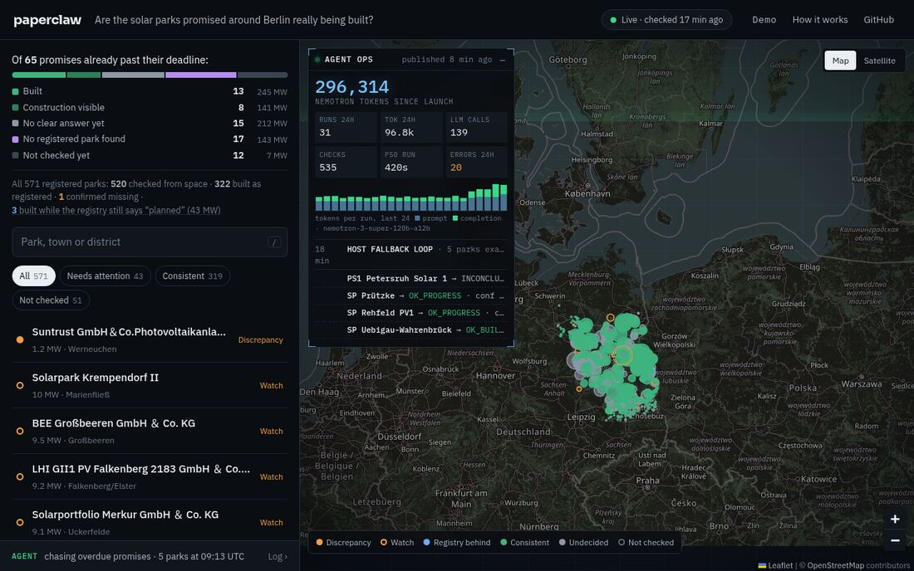
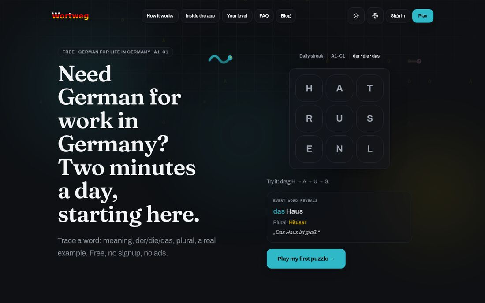

<!-- Generated by scripts/sync_portfolio.py from data/life.json. -->
<h1 align="center">Hi, I'm Edgar Abasov 👋</h1>

  

  
  
  
  

### About me

- 📍 **Berlin, Germany** · Originally from Georgia.
- 🛠️ **Co-founder & COO at [stamo.AI](https://stamoai.com)** — branded AR effects for TikTok, Instagram, and Snapchat.
- 💼 Previously **AI Engineer at Bank of Georgia**, building Georgian/English chatbot features.
- 🎓 **B.Sc. Computer Science** · Erasmus+ Data Science courses at HAW Kiel.
- ☁️ **AWS Certified Machine Learning – Specialty** · Azure Data Scientist Associate.

### What I'm working on

- Running paperclaw — an agent that keeps checking whether the solar parks promised around Berlin actually get built.
- Next: German C1 in Potsdam.

### Tech stack

  

  
  
  
  

### Featured projects

  
  

| Project | What I built |
| :--- | :--- |
| [paperclaw](https://metaphysicist1.github.io/papercrawl/) | An always-on agent that checks 571 registered solar parks in Berlin/Brandenburg against the official registry and Sentinel-2 satellite images, and flags megawatts that exist only on paper. Built for the NVIDIA Berlin Claw Agent Challenge. |
| [Wortweg](https://wortweg.online) | A daily German word puzzle: trace a word on the grid, get its der/die/das, plural and a real example. A1–C1, free, no signup, no ads. |
| [Supply-AI-Agent](https://github.com/Metaphysicist1/Supply-AI-Agent) | Supply-chain agent on Gemini and LangGraph, deployed on Google Cloud. |
| [PneuNet](https://github.com/Metaphysicist1/PneuNet) | Pneumonia detection from chest X-rays. PyTorch CNN behind FastAPI, on Cloud Run. |

**Also shipped:** [Neuro Timer](https://neuro-timer.netlify.app/) · [Clustar](https://www.kaggle.com/datasets/edgarabasov/star-observations-dataset) · [CoverBot](https://coverbot-edgar-abasov.streamlit.app/) · Berlin Flat Search (Telegram bot).

📸 See paperclaw & Wortweg in action

**[paperclaw](https://metaphysicist1.github.io/papercrawl/)**

**[Wortweg](https://wortweg.online)**

### GitHub activity

  
  

More about my background

- **Bank of Georgia · Oct 2023–Sep 2024:** raised chatbot accuracy by 15%; shipped Georgian/English features.
- **Python educator · 2021–2024:** taught 80+ children aged 12–14 through Pygame projects.
- **BSU · Mar 2021–Mar 2022:** speech-to-text research with spectrograms and FFT.
- **B.Sc. Computer Science · 2024:** Shota Rustaveli State University, Batumi.
- **HAW Kiel · 2026:** Erasmus+ year; Master's Data Science courses in ML, cloud computing, and data management.
- **Learning:** Mathematics for ML and Data Science (2025); German B2 completed, C1 next.

---

  <b>Have something interesting to build?</b> 
  <a href="mailto:edgarabasov1@gmail.com">Let's talk.</a>

