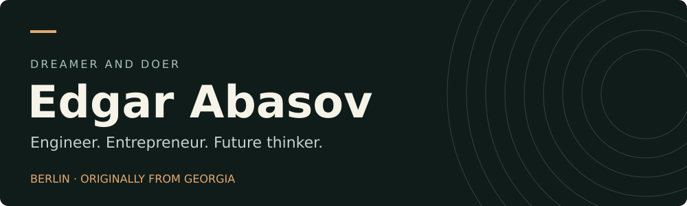
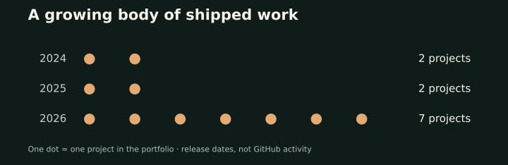

<!-- Generated by scripts/sync_portfolio.py from data/life.json. -->

# Hi, I'm Edgar Abasov

I build AI agents, useful software, and experiments that make it into the world.
Co-founder & COO at [stamo.AI](https://stamoai.com); previously an AI Engineer at Bank of Georgia.

**[Portfolio](https://www.edgarabasov.website)** · [LinkedIn](https://www.linkedin.com/in/edgar-abasov/) · [X](https://x.com/AbasovEdgar) · [Email](mailto:edgarabasov1@gmail.com)

## Now

- Running paperclaw — an agent that keeps checking whether the solar parks promised around Berlin actually get built.
- Next: German C1 in Potsdam.

## Selected work

### paperclaw

An always-on agent that checks 571 registered solar parks in Berlin/Brandenburg against the official registry and Sentinel-2 satellite images, and flags megawatts that exist only on paper. Built for the NVIDIA Berlin Claw Agent Challenge.

[Open paperclaw](https://metaphysicist1.github.io/papercrawl/)

### Wortweg

A daily German word puzzle: trace a word on the grid, get its der/die/das, plural and a real example. A1–C1, free, no signup, no ads.

[Open Wortweg](https://wortweg.online)

### stamo.AI

Co-founded it; I'm COO. Started as text-to-video and won the MediaLab 5,000 Lari prize in 2024. Today it generates branded AR effects for TikTok, Instagram and Snapchat.

[Explore stamo.AI](https://stamoai.com)

## More things I've shipped

| Project | What it does |
| :--- | :--- |
| [ClipVault](https://github.com/Metaphysicist1/ClipVault) | Clipboard history for GNOME. GTK4, no cloud, no telemetry. |
| [White-Label AI Concierge](https://github.com/Metaphysicist1/White-Label-AI-Concierge) | FastAPI + LangGraph assistant you can point at any website or pile of PDFs. |
| [Supply-AI-Agent](https://github.com/Metaphysicist1/Supply-AI-Agent) | Supply-chain agent on Gemini and LangGraph, deployed on Google Cloud. |
| [Neuro Timer](https://neuro-timer.netlify.app/) | Focus timer with work protocols. Desktop and web. |
| [PneuNet](https://github.com/Metaphysicist1/PneuNet) | Pneumonia detection from chest X-rays. PyTorch CNN behind FastAPI, on Cloud Run. |
| [Clustar](https://www.kaggle.com/datasets/edgarabasov/star-observations-dataset) | Clustering star observations. Published the dataset on Kaggle. |
| [CoverBot](https://coverbot-edgar-abasov.streamlit.app/) | Ask questions to your documents. RAG on Gemini and Streamlit. |
| Berlin Flat Search | My Telegram bot for the Berlin/Potsdam flat hunt. It watches Kleinanzeigen, posts each new listing with rent, size and rooms, flags the cheap ones, and lets me mark them saved, applied or removed from the chat. |

## The longer arc

Projects behind the dots

- **2024:** stamo.AI, CoverBot.
- **2025:** PneuNet, Clustar.
- **2026:** Neuro Timer, White-Label AI Concierge, Supply-AI-Agent, Berlin Flat Search, Wortweg, ClipVault, paperclaw.

Counts include these 11 software and data projects from my portfolio. Education, certifications, employment, and goals are excluded. These are recorded release dates, not contribution statistics.

## Experience & foundations

- **Bank of Georgia · AI Engineer · Oct 2023–Sep 2024.** Raised chatbot accuracy by 15%; shipped Georgian/English features.
- **Python educator · 2021–2024.** Taught 80+ children aged 12–14, building games in Pygame.
- **BSU · Speech-to-text research · Mar 2021–Mar 2022.** Spectrograms, FFT, and a web application.
- **B.Sc. Computer Science**, Shota Rustaveli State University, Batumi · 2024.
- **Erasmus+ year at HAW Kiel** · 2026. Master's Data Science courses in machine learning, cloud computing, and data management.

**Tools used across these projects:** Python · LangGraph · FastAPI · PyTorch · Gemini · Streamlit · Google Cloud · GTK4

**Certifications & learning:** AWS Certified Machine Learning – Specialty (2025) · Azure Data Scientist Associate (2021) · Mathematics for ML and Data Science (2025).

**Beyond code:** German B2 completed; working toward C1 in Potsdam. Still aiming to build a world-class startup and win an international hackathon.

---

Content from my <a href="https://github.com/Metaphysicist1/ultra-portfolio/blob/main/public/data/life.json">portfolio log</a> · Source updated 2026-10-02. Graphics are stored in this repository; project images are screenshots from the portfolio.
