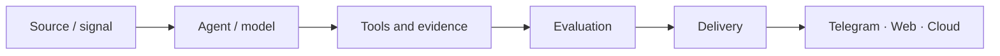

<!-- Generated by scripts/sync_portfolio.py from data/life.json. -->
<h1 align="center">Hi, I'm Edgar Abasov 👋</h1>

<p align="center">
  <a href="https://www.edgarabasov.website">
    
  </a>
</p>

<p align="center">
  <a href="https://www.edgarabasov.website"></a>
  <a href="https://www.linkedin.com/in/edgar-abasov/"></a>
  <a href="https://x.com/AbasovEdgar"></a>
  <a href="mailto:edgarabasov1@gmail.com"></a>
</p>

## At a glance

```text
Berlin, Germany       Co-founder / COO — stamo.AI
AI Engineer           AWS ML Specialty + Azure Data Scientist
Production focus      Agents · RAG · Computer vision · Developer tools
Current challenge     Turning reliable prototypes into products people use
```

## Production systems

| | |
|:--|:--|
| **[paperclaw](https://github.com/Metaphysicist1/papercrawl)**<br/>Monitors 571 solar parks against official records and satellite imagery. | **[relay](https://github.com/Metaphysicist1/relay)**<br/>Runs one prompt across parallel coding agents in isolated git worktrees. |
| **[unimate](https://github.com/Metaphysicist1/unimate)**<br/>AI-powered German university admissions companion at [unimate.study](https://unimate.study). | **[ai-radar](https://github.com/Metaphysicist1/ai-radar)**<br/>Scheduled AI engineering intelligence with daily digests and Telegram alerts. |
| **[Supply-AI-Agent](https://github.com/Metaphysicist1/Supply-AI-Agent)**<br/>Gemini + LangGraph supply-chain agent deployed on Google Cloud. | **[telegram-daily-delivery](https://github.com/Metaphysicist1/telegram-daily-delivery)**<br/>Encrypted, deterministic delivery with durable duplicate suppression. |

## Why it matters

| Credibility | Proof |
|:--|:--|
| **Model quality** | Raised chatbot accuracy by **15%** at Bank of Georgia |
| **Independent monitoring** | Evaluates **571** solar parks across Berlin/Brandenburg |
| **Cloud + ML** | AWS ML Specialty · Azure Data Scientist Associate |
| **Leadership** | Co-founder & COO at [stamo.AI](https://stamoai.com) · 80+ students taught |
| **Engineering base** | Python · LangGraph · FastAPI · Gemini · Docker · Google Cloud |

## Selected shipped products

| Product | Result |
|:--|:--|
| [Wortweg](https://wortweg.online) | Free daily German word puzzle for A1–C1, built without signup or ads |
| Berlin Flat Search | Telegram workflow for listing discovery, filtering, saving, and applications |
| [PneuNet](https://github.com/Metaphysicist1/PneuNet) | PyTorch chest-X-ray classifier exposed as a Cloud Run API |
| [Neuro Timer](https://neuro-timer.netlify.app/) | Focus timer and productivity protocols for desktop and web |
| [ClipVault](https://github.com/Metaphysicist1/ClipVault) | Private GNOME clipboard history built with GTK4 |

## Current operating areas



**Now:** shipping agentic monitoring, parallel developer workflows, and reliable notification systems.
**Interested in:** production evals, observability, encrypted delivery, local-first software, and applied RAG.

## Experience & credentials

| Role | Impact |
|:--|:--|
| **AI Engineer · Bank of Georgia** | Raised chatbot accuracy by 15% and shipped Georgian/English features |
| **Co-founder & COO · stamo.AI** | Building branded AR effects for TikTok, Instagram, and Snapchat |
| **Python educator** | Taught programming to 80+ students aged 12–14 |
| **Research** | Speech-to-text, spectrogram and FFT work |
| **Education** | B.Sc. Computer Science · Erasmus+ at HAW Kiel |
| **Certifications** | AWS Certified ML – Specialty · Azure Data Scientist Associate |

## Built with

<p>
  
  &nbsp;
  
  
</p>

<details>
<summary><b>Selected screenshots</b></summary>

<br/>

[](https://metaphysicist1.github.io/papercrawl/)

[](https://wortweg.online)

</details>

<p align="center">
  <b>Have something interesting to build?</b><br />
  <a href="mailto:edgarabasov1@gmail.com">Let's talk.</a>
</p>
